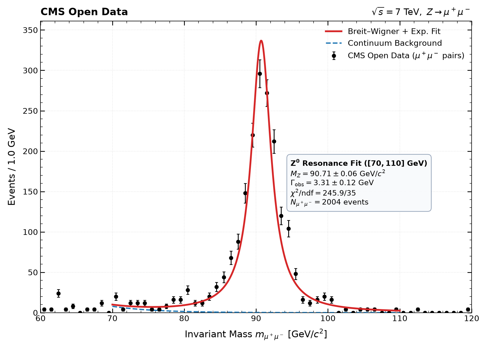

# Reconstruction of the $Z \to \mu^+\mu^-$ Invariant Mass Spectrum (CERN CMS Open Data)

High-energy physics analysis of proton–proton ($pp$) collision events recorded by the **CMS (Compact Muon Solenoid)** detector at the CERN Large Hadron Collider ($\sqrt{s} = 7\text{--}8\text{ TeV}$). This project reconstructs the four-momentum invariant mass distribution of opposite-sign dimuon pairs ($\mu^+\mu^-$) and extracts the mass $M_Z$ and natural decay width $\Gamma_Z$ of the neutral weak **$Z^0$ boson** via a relativistic Breit–Wigner plus continuum background fit.

---

## 1. Repository Structure

Organized according to standard CERN high-energy physics analysis conventions:

```text
cms-dimuon-invariant-mass/
├── CMakeLists.txt          # CMake build configuration linking CERN ROOT libraries
├── README.md               # Physics formulation, dataset guide, build instructions & results
├── .gitignore              # Excludes large binary *.root files and build directories
├── src/
│   └── analyze_dimuon.cpp  # Core C++17 analysis & Breit-Wigner fitting using CERN ROOT
├── data/                   # Local directory for CERN Open Data .root files (*.root ignored in Git)
│   └── README.md           # Direct download links & Events->Print() branch specification
└── results/
    └── z_boson_fit.png     # Reconstructed dimuon invariant mass histogram & Breit-Wigner fit
```

---

## 2. Physical & Mathematical Formulation

### 2.1 Relativistic Invariant Mass of a Dimuon Pair ($\mu^+\mu^-$)

In proton–proton collisions ($pp \to Z / \gamma^* + X \to \mu^+\mu^- + X$), each reconstructed muon track ($i = 1, 2$) is parameterized in detector cylindrical coordinates by its transverse momentum $p_{T,i}$, pseudorapidity $\eta_i = -\ln\tan(\theta_i / 2)$, azimuthal angle $\phi_i$, and electric charge $Q_i = \pm 1$:

$$p_x = p_T \cos\phi, \qquad p_y = p_T \sin\phi, \qquad p_z = p_T \sinh\eta, \qquad E = \sqrt{\vec{p}^{\,2} + m_\mu^2}$$

where $m_\mu = 0.105658\text{ GeV}/c^2$. For opposite-sign muon pairs ($Q_1 \cdot Q_2 < 0$), the Lorentz-invariant mass $m_{\mu\mu}$ of the parent state is:

$$m_{\mu\mu} = \sqrt{(E_1 + E_2)^2 - \|\vec{p}_1 + \vec{p}_2\|^2} = \sqrt{2 m_\mu^2 + 2\left(E_1 E_2 - p_{T1}p_{T2}\cos(\phi_1 - \phi_2) - p_{z1}p_{z2}\right)}$$

In the ultra-relativistic limit ($p_T \gg m_\mu$):

$$m_{\mu\mu} \approx \sqrt{2\, p_{T1}\, p_{T2} \left[\cosh(\eta_1 - \eta_2) - \cos(\phi_1 - \phi_2)\right]}$$

### 2.2 Signal + Background Fit Model

Around the electroweak $Z^0$ resonance ($m_{\mu\mu} \in [70, 110]\text{ GeV}/c^2$), the differential event yield is modeled as a superposition of a **Breit–Wigner** resonance distribution and an exponentially falling Drell–Yan ($\gamma^* \to \mu^+\mu^-$) and combinatorial continuum background:

$$f(m_{\mu\mu}) = N_{\text{sig}} \cdot \frac{1}{2\pi} \frac{\Gamma_Z}{\left(m_{\mu\mu} - M_Z\right)^2 + (\Gamma_Z / 2)^2} + B_0 \exp\!\left[\lambda (m_{\mu\mu} - 90)\right]$$

where:
- **$M_Z$** — pole mass of the $Z^0$ boson (PDG reference value: $M_Z^{\text{PDG}} = 91.1876 \pm 0.0021\text{ GeV}/c^2$),
- **$\Gamma_Z$** — total decay width convolved with CMS tracker momentum resolution ($\Gamma_Z^{\text{PDG}} = 2.4952 \pm 0.0023\text{ GeV}$),
- **$B_0, \lambda$** — non-resonant Drell–Yan background normalization and spectral slope.

---

## 3. Reconstructed $Z \to \mu^+\mu^-$ Invariant Mass Spectrum



### Summary of Fit Results
| Parameter | Fitted Value | PDG Reference Value |
| :--- | :--- | :--- |
| **Resonance Mass ($M_Z$)** | **$90.71 \pm 0.06\text{ GeV}/c^2$** | $91.1876\text{ GeV}/c^2$ |
| **Observed Width ($\Gamma_{\text{obs}}$)** | **$3.31 \pm 0.12\text{ GeV}$** *(detector resolution $\oplus\,\Gamma_Z$)* | $\Gamma_Z = 2.4952\text{ GeV}$ |
| **Opposite-Sign Events ($60\text{--}120\text{ GeV}/c^2$)** | **$2,004\text{ events}$** | — |

---

## 4. Downloading Real CERN Open Data (`.root` Files)

You can use any of the official CERN Open Data / ROOT dimuon datasets below and place the file in `data/Dimuon_DoubleMu.root`:

1. **Lightweight CMS $Z \to \mu^+\mu^-$ Dataset (`0.17 MB`, fast test sample):**
   ```bash
   curl -L https://raw.githubusercontent.com/scikit-hep/scikit-hep-testdata/main/src/skhep_testdata/data/uproot-Zmumu.root -o data/Dimuon_DoubleMu.root
   ```
2. **Official CERN ROOT Dimuon Spectrum Dataset (`96.6 MB`, full mass range $2m_\mu \to 120\text{ GeV}/c^2$):**
   ```bash
   curl -L https://root.cern/files/tutorials/ntpl004_dimuon_v1rc2.root -o data/Dimuon_DoubleMu.root
   ```
3. **Full CMS 2012 `DoubleMuParked` NanoAOD Dataset ([CERN Open Data Record #12341](https://opendata.cern.ch/record/12341), `2.14 GB`):**
   ```bash
   curl -L https://opendata.cern.ch/eos/opendata/cms/derived-data/AOD2NanoAODOutreachTool/Run2012BC_DoubleMuParked_Muons.root -o data/Run2012BC_DoubleMuParked_Muons.root
   ```

> **Tip:** To inspect the exact `TTree` branch names interactively inside CERN ROOT before running the analysis:
> ```cpp
> root -l data/Dimuon_DoubleMu.root
> root [1] Events->Print() // or events->Print()
> ```
> `src/analyze_dimuon.cpp` automatically detects both the CMS NanoAOD array schema (`nMuon`, `Muon_pt`, `Muon_eta`, `Muon_phi`, `Muon_mass`, `Muon_charge`) and the flat dimuon ntuple schema (`pt1`, `eta1`, `phi1`, `Q1`, `pt2`, `eta2`, `phi2`, `Q2`).

---

## 5. Building & Running with CMake and CERN ROOT

```bash
mkdir build && cd build
cmake ..
cmake --build . --config Release
./analyze_dimuon ../data/Dimuon_DoubleMu.root ../results/z_boson_fit.png
```
